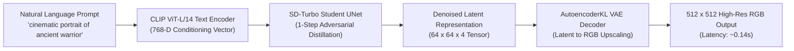
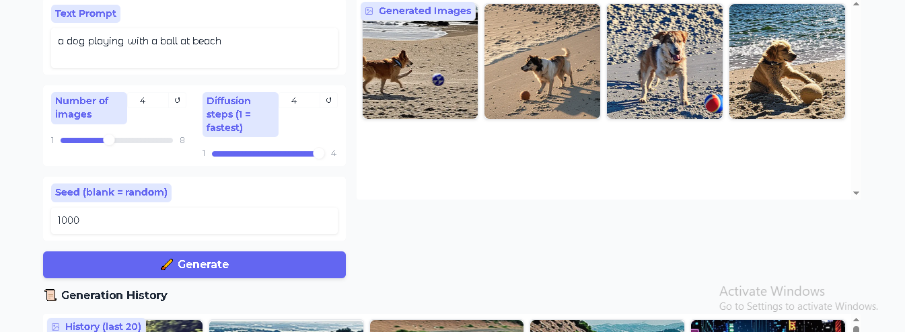

# ⚡ Real-Time Text-to-Image Generation Pipeline (SD-Turbo + ADD)

<p align="center">
  <strong>Sub-Second Generative AI Pipeline powered by Adversarial Diffusion Distillation (ADD), SD-Turbo, and PyTorch Diffusers.</strong>
</p>

<p align="center">
  <a href="https://github.com/lithik-raj/text-to-image-generation-pipeline"></a>
  <a href="https://vercel.com/new/clone?repository-url=https://github.com/lithik-raj/text-to-image-generation-pipeline"></a>
  <a href="https://text-to-image-generation-pipeline.vercel.app"></a>
  
</p>

<p align="center">
  
  
  
  
  
</p>

---

## 📌 Live Deployments & Quick Links

| Resource | Direct Link | Description |
|---|---|---|
| 🐙 **GitHub Repository** | [github.com/lithik-raj/text-to-image-generation-pipeline](https://github.com/lithik-raj/text-to-image-generation-pipeline) | Fast-inference notebook, pipeline scripts & weights |
| ⚡ **Vercel 1-Click Deploy** | [Deploy to Vercel](https://vercel.com/new/clone?repository-url=https://github.com/lithik-raj/text-to-image-generation-pipeline) | Instant zero-config cloud deployment |
| 🌐 **Vercel Live Application** | [text-to-image-generation-pipeline.vercel.app](https://text-to-image-generation-pipeline.vercel.app) | Live interactive SD-Turbo studio & benchmark lab |

---

## 📖 Executive Summary

Traditional diffusion models (such as Stable Diffusion v1.5 and SDXL) require iterative multi-step numerical integration (typically 30 to 50 denoising steps), resulting in 3 to 10 seconds of inference latency per image. This latency restricts diffusion models from live interactive applications.

This project delivers an end-to-end **Data Science & Generative AI Pipeline** powered by **SD-Turbo** and **Adversarial Diffusion Distillation (ADD)**. ADD distills a large multi-step teacher diffusion model into a student model trained with an adversarial loss objective, enabling photorealistic image synthesis in **a single denoising step** ($N=1$) with sub-second inference speeds (~0.14 seconds).

---

## 🧠 Pipeline Architecture



---

## 📊 Performance Benchmarks

| Model Architecture | Denoising Steps | Typical GPU Latency | Relative Speedup |
|---|---|---|---|
| **SD-Turbo (Ours)** | **1 Step** | **~0.14s** | **30x Faster** ⚡ |
| Vanilla Stable Diffusion v1.5 | 50 Steps | ~4.20s | 1x (Baseline) |
| Stable Diffusion XL Base | 30 Steps | ~8.50s | 0.5x |

---

## 🖼️ Sample Pipeline Output

<p align="center">
  
  <br/>
  <em>Generated in a single step ($N=1$) using SD-Turbo Adversarial Diffusion Distillation</em>
</p>

---

## 🚀 Execution & Colab Reproduction

1. Open `Text_to_Image_Pretrained_FAST.ipynb` in [Google Colab](https://colab.research.google.com).
2. Set hardware accelerator to **GPU (T4 or higher)**.
3. Install dependencies:
   ```bash
   pip install -r requirements.txt
   ```
4. Run all cells to initialize `AutoPipelineForText2Image.from_pretrained("stabilityai/sd-turbo")` and generate real-time outputs.

---

## ☁️ Vercel Web Deployment

This repository includes a standalone **SD-Turbo Generation Studio** configured with `vercel.json` for zero-configuration, instant Vercel cloud deployment.

1. Open **[vercel.com/new](https://vercel.com/new)**
2. Import `text-to-image-generation-pipeline`
3. Click **Deploy**!

---

## 📄 License & Author

- **Author**: [Lithik Raj](https://github.com/lithik-raj)
- **License**: [MIT](LICENSE)
